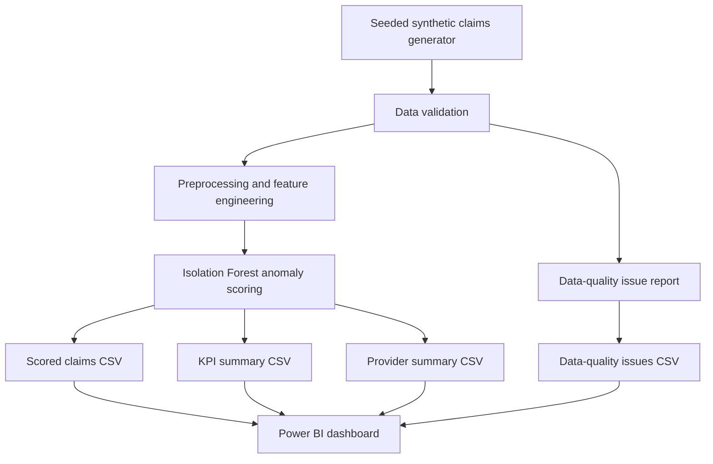

# ClaimShield AI

**Synthetic healthcare-claims analytics and anomaly-review pipeline with a Power BI dashboard.**

ClaimShield AI demonstrates a reproducible data workflow: generate synthetic claims-like records, validate data quality, prepare features, score potential anomalies, export summaries, and explore results in Power BI.

> **Important:** This project uses synthetic data for educational demonstration. An anomaly flag is a review signal, not proof of fraud. This is not a validated fraud-detection system or a production healthcare decision tool.

## Features

- Reproducible synthetic claims generation using a row count and random seed.
- Data-quality checks, including duplicate claim identifiers and missing provider identifiers.
- Preprocessing, feature engineering, and Isolation Forest anomaly scoring.
- CSV exports for scored claims, KPI summaries, provider summaries, and data-quality issues.
- Automated tests for validation, scoring, reporting invariants, and reproducibility.
- Power BI report for executive KPIs, claim status, provider review rates, data-quality findings, and review queue.

## Architecture



## Repository layout

```text
claimshield-ai/
├── configs/                 # Project configuration
├── data/
│   ├── raw/                 # Local generated input data (ignored by Git)
│   └── processed/           # Local intermediate data (ignored by Git)
├── docs/                    # Architecture, data dictionary, evaluation and demo guide
├── outputs/                 # Local generated reports (ignored by Git)
├── reports/
│   └── ClaimShield_AI_Dashboard.pbix
├── sql/
│   ├── schema.sql
│   └── profiling.sql
├── src/claimshield/         # Pipeline modules and CLI
├── tests/                   # Automated tests
└── ...
```

## Requirements

- Python version compatible with `requirements.txt`
- Git
- Power BI Desktop to open and refresh the `.pbix` report

## Setup on Windows PowerShell

From the repository root:

```powershell
py -3 -m venv .venv
.\.venv\Scripts\python.exe -m pip install --upgrade pip
.\.venv\Scripts\python.exe -m pip install -r requirements.txt
.\.venv\Scripts\python.exe -m pip install -e .
```

Check the Python version selected by the launcher with `py -3 --version`.

## Run the pipeline

```powershell
.\.venv\Scripts\python.exe -m claimshield.cli --rows 1000 --seed 42
```

Expected generated files:

- `data/raw/synthetic_claims.csv`
- `outputs/scored_claims.csv`
- `outputs/kpi_summary.csv`
- `outputs/provider_summary.csv`
- `outputs/data_quality_issues.csv`

Generated data and reports are excluded from version control by default. Re-run the command to regenerate them locally.

## Run tests

```powershell
.\.venv\Scripts\python.exe -m pytest -q
```

The development checkpoint recorded **12 passed** on the user's Windows environment. Re-run tests after code changes; this result should not be assumed for a different revision or environment.

## Power BI dashboard

Open `reports/ClaimShield_AI_Dashboard.pbix` in Power BI Desktop. The report uses generated CSV files under `outputs/`. After regenerating outputs, refresh the imported CSV sources and reconcile KPI cards against `outputs/kpi_summary.csv`.

See [dashboard documentation](docs/power_bi_dashboard.md) and [demo guide](docs/demo_guide.md).

## Verified synthetic demo run

For the seeded 1,000-row run recorded during development:

| Metric | Observed value |
|---|---:|
| Input claims | 1,000 |
| Total claim amount | ₹204,232.39 |
| Total paid amount | ₹116,751.08 |
| Review candidates | 50 |
| Review-candidate rate | 5.0% |
| Denied claims | 114 |
| Denial rate | 11.4% |

These are synthetic-data outputs, not real-world healthcare statistics or model-performance results. Regenerate the pipeline outputs to reproduce and confirm them.

## Evaluation and limitations

- The synthetic dataset does not establish real-world fraud labels or prevalence.
- Isolation Forest's contamination parameter is an assumed outlier proportion for thresholding, not measured fraud prevalence or accuracy.
- No real-world precision, recall, F1, ROC-AUC, PR-AUC, financial savings, or operational impact is claimed.
- Provider review rates are descriptive and should be interpreted alongside claim volumes and data-quality limitations.
- A real deployment would require privacy/security controls, domain review, labeled validation data, monitoring, governance, and human oversight.

See [evaluation protocol](docs/evaluation.md).

## Development workflow

```powershell
git diff --check
.\.venv\Scripts\python.exe -m pytest -q
git status --short
```

## License

See [LICENSE](LICENSE).## Labeled synthetic-dataset evaluation

The optional evaluation module benchmarks Isolation Forest against labels in the synthetic Health Claims sample. It uses a stratified holdout split, fits preprocessing and Isolation Forest on training features only, and calculates metrics on held-out labels.

```powershell
.\.venv\Scripts\python.exe -m claimshield.evaluation --input data/external/claims_sample.csv --output-dir outputs/evaluation --contamination 0.05 --seed 42
```

Outputs:
- `outputs/evaluation/evaluation_metrics.json`
- `outputs/evaluation/evaluation_metrics.csv`
- `outputs/evaluation/evaluation_predictions.csv`
- `outputs/evaluation/confusion_matrix.csv`

This evaluates generated labels only. It does not demonstrate real-world fraud detection. See `docs/dataset_card.md` and `docs/labeled_evaluation.md`.
