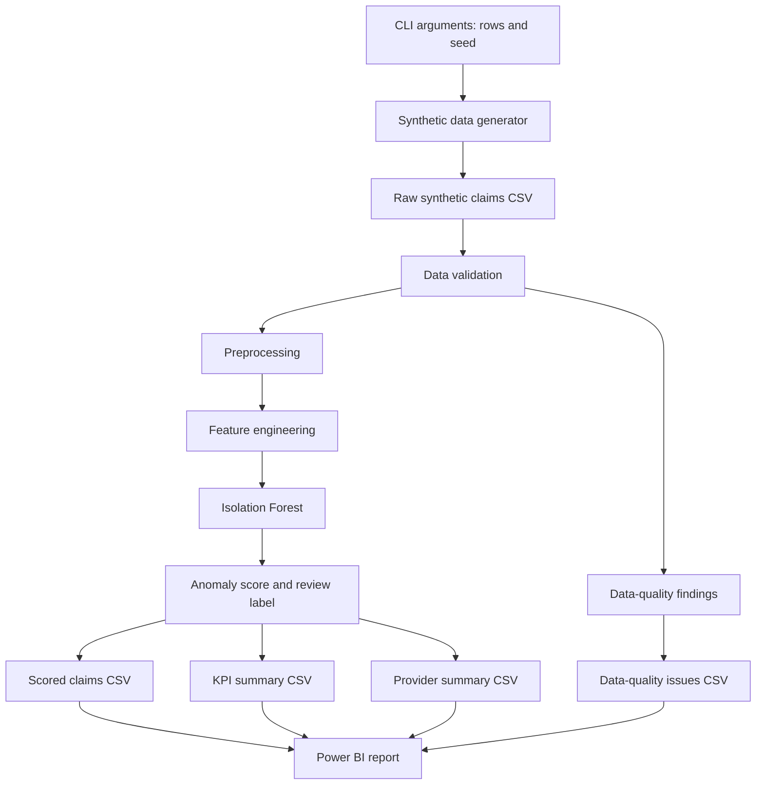

# ClaimShield AI Architecture

## Components

- **Synthetic data generator:** creates claims-like records for repeatable development and demonstrations.
- **Data validation:** checks selected data-quality conditions and emits findings.
- **Preprocessing and feature engineering:** prepares fields used by the analytics model.
- **Anomaly detection:** uses Isolation Forest to score records and label review candidates.
- **Reporting:** exports row-level results and summary CSV files.
- **Power BI:** presents descriptive KPIs, claim status, provider comparisons, data-quality findings, and the review queue.

## Module summary

| Module | Responsibility |
|---|---|
| `synthetic_data.py` | Deterministic, fictional claim-like records for development |
| `data_validation.py` | Reports missing columns, duplicate IDs, invalid amounts, and date issues |
| `preprocessing.py` | Normalizes types and strings without silently dropping records |
| `features.py` | Creates numeric features for the anomaly baseline |
| `anomaly_detection.py` | Fits Isolation Forest and marks a configurable proportion of rows as review candidates |
| `reporting.py` | Writes scored records, KPIs, provider summaries, and quality issues as CSV |
| `cli.py` | Orchestrates the end-to-end pipeline; reads defaults from `configs/config.yaml` |
| `sql/` | SQLite-compatible schema and profiling queries |

## Data flow

The CLI orchestrates generation, validation, scoring, and report export. CSV files connect Python outputs to Power BI. Generated files are local artifacts and ignored by Git by default; source code, tests, documentation, and the `.pbix` report are version-controlled.

## Design boundaries

This is a portfolio MVP, not a production service. It does not make claim payment decisions, establish fraud, or replace human investigation. Real deployment would require secure ingestion, access controls, audit trails, privacy review, monitoring, model governance, and evaluation against appropriately labeled data.
